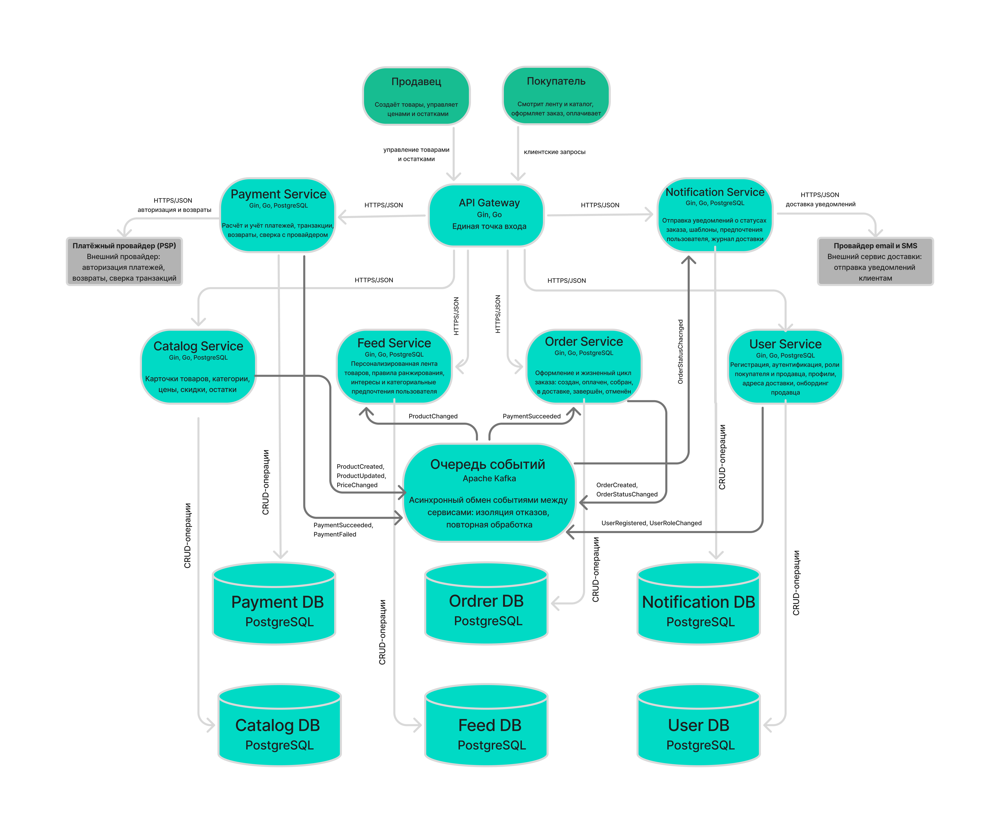

# Маркетплейс — архитектура системы

Архитектурное проектирование системы маркетплейса (C4 + инициализация сервисов)
Цифровая платформа, на которой продавцы размещают товары, а покупатели оформляют заказы. Спроектирована как система микросервисов: 6 доменных сервисов, отдельная база данных у каждого, асинхронный обмен событиями через очередь. Бизнес-логика не реализована, поднят один сервис

## 1. C4 Container Diagram


Светлые стрелки это синхронные вызовы по HTTPS/JSON, темные это асинхронный обмен событиями через очередь. Стрелки к базам  операции CRUD внутри одного сервиса

## 2. Контекст

Внутри платформы: API Gateway, 6 сервисов, очередь событий, 6 баз данных.
Снаружи две внешние системы:
- **Платёжный провайдер (PSP)** - авторизация платежей, возвраты, сверка транзакций. В него ходит только Payment Service.
- **Провайдер email и SMS** - доставка уведомлений. В него ходит только Notification Service.
Пользователи платформы - покупатель и продавец. Оба работают через API Gateway.

## 3. Домены
**Catalog + Pricing & Stock.** Карточки товаров, категории, атрибуты, картинки. Цены, скидки, остатки. Сюда же управление каталогом со стороны продавцов.
**Identity & Access.** Регистрация, вход, роли покупателя и продавца, профили, адреса доставки, онбординг продавца.
**Feed.** Персонализированная лента, правила ранжирования, интересы пользователя.
**Order.** Оформление заказа и его жизненный цикл: создан, оплачен, собран, в доставке, завершён, отменён. Плюс история переходов между статусами.
**Payment.** Расчёт и учёт платежей, транзакции, возвраты, сверка с провайдером.
**Notification.** Уведомления о статусах заказа, шаблоны, журнал доставки.

## 4. Какие домены в каких сервисах

**Catalog Service - Catalog и Pricing & Stock.** Цены и остатки меняются в разы чаще, чем карточки товаров, но это всё равно один процесс управления каталогом.
**User Service - Identity & Access.** Логин и профиль описывают одного и того же человека, делить тут нечего.
**Feed Service - Feed.** У ленты своя модель данных, свой темп изменений и очень много чтений, живёт отдельно.
**Order Service - Order.** Заказ - отдельный процесс со своим циклом.
**Payment Service - Payment.** Отдельный сервис, чтобы сбой платежей не блокировал оформление заказа.
**Notification Service - Notification.** Отправка уведомлений это побочный эффект смены статуса, на сам статус не влияет.

## 5. Владение данными

**API Gateway** - данных не имеет, только роутит запросы ко всем шести сервисам по HTTPS/JSON.
**Catalog Service** - своя Catalog DB. Наружу отдаёт в очередь: ProductCreated, ProductUpdated, PriceChanged. Асинхронно.
**User Service** - своя User DB. В очередь: UserRegistered, UserRoleChanged. Асинхронно.
**Feed Service** - своя Feed DB. Наружу ничего не отдаёт.
**Order Service** - своя Order DB. В очередь: OrderCreated, OrderStatusChanged. Асинхронно.
**Payment Service** - своя Payment DB. Ходит в платёжного провайдера, синхронно по HTTPS/JSON.
**Notification Service** - своя Notification DB. Ходит в провайдер email и SMS, синхронно по HTTPS/JSON.

У каждого сервиса ровно одна база, чужую никто не трогает. Данные передаются только через API или через события, кросс-сервисные JOIN запрещены. Прямых связей между сервисами тоже нет. Если с диаграммы убрать блок очереди, между сервисами не останется ни одной стрелки - весь обмен идёт через события: кто-то публикует факт, кто-то его читает.

Ппрохождение заказа
OrderCreated, Payment Service забирает событие,платёжный провайдер: авторизация, PaymentSucceeded или PaymentFailed, Order Service меняет статус заказа, OrderStatusChanged, Notification Service отправляет письмо


При `PaymentFailed` заказ переводится в `CANCELLED` - это компенсация. Единой транзакции нет, потому что общая база запрещена: шаги выполняются последовательно, а неудачный шаг откатывается обратным действием. Отказ платёжного контура не блокирует оформление заказа.

## 6. Варианты декомпозиции

**Вариант А - крупнозернистые сервисы.** 3 сервиса: Продажи (Catalog + Feed + Order), Платежи (Payment), Пользователи (User + Notification). Асинхронный обмен не нужен, взаимодействие внутри сервисов идёт через обычные вызовы.
**Вариант Б - модульный монолит.** Один развёртываемый модуль с внутренними пакетами `catalog`, `user`, `feed`, `order`, `payment`, `notification`. Одна база данных, разделённая по схемам. Внешние взаимодействия - только HTTP.
**И мой вариант - доменные микросервисы (выбран).** 6 сервисов, по одному на домен, у каждого своя БД, обмен событиями через очередь.

## 7. Trade-offs вариантов

### А. Крупнозернистые

Плюсы:
- сетевых вызовов заметно меньше
- внутри «Продаж» можно обойтись обычными транзакциями, а не компенсациями
- дешевле в эксплуатации: нет очереди, нет повторов
Минусы:
- «Продажи» быстро превращаются в God Service - каталог, лента и заказы слипаются
- лента и заказы в одном сервисе, значит общий деплой и общий отказ
- платежи отделены хуже, чем в варианте А
- границы доменов внутри сервиса размываются первыми

### Б. Модульный монолит

Плюсы:
- дёшево начать, нет распределённых проблем
- обычные ACID-транзакции, компенсации не нужны
- ленту всё равно придётся вынести наружу, когда вырастет нагрузка

Минусы:
- одна база на все модули - это прямо нарушает требование задания
- один деплой монолита - регресс сразу во всех модулях
- без жёстких правил импортов модули превращаются в спагетти
- масштабировать по частям сложнее


### В. Доменные микросервисы

Плюсы:
- у каждого своя база, границы владения чёткие
- сбой платежей не роняет оформление заказа
- лента масштабируется отдельно от платежей - трафик чтений не мешает критичным операциям
- сервисы можно пилить параллельно

Минусы:
- 6 сетевых вызовов вместо вызовов внутри процесса
- единых транзакций нет, нужна очередь и компенсации
- нужна инфраструктура очереди, повторы и наблюдаемость
- обработчики приходится делать идемпотентными, данные становятся eventually consistent

## 8. Обоснование выбранного варианта

Выбран **вариант В — доменные микросервисы**.

**Под требования кейса.** Шесть функций из кейса - лента, каталог, пользователи, заказы, платежи, уведомления - закрываются шестью сервисами один к одному. Соответствие видно сразу.
**Нагрузки разные.** Лента - это чтения с резкими пиками. Платежи - 2% запросов, но 100% критичности. В варианте В они масштабируются отдельно. В варианте А «Продажи» станут общим узким местом.
**Риски изолированы.** Сбой платежного контура не должен блокировать оформление заказа, а сбой ленты портить заказы. Очередь решает это на уровне архитектуры.
**Вариант Б просто не проходит.** Задание прямо запрещает разделяемые базы между сервисами, а монолит по определению использует одну базу. Критерий не закрывается.

## Инструкция запуска

Требуется Docker с поддержкой `docker compose` (v2)

**Запуск:**

```bash
docker compose up --build -d
```

**Проверка состояния контейнера:**

```bash
docker compose ps
```

Ожидаемый вывод:  статус `healthy`:

```
NAME STATUS              PORTS
notification-service     Up 5 seconds      0.0.0.0:8080->8080/tcp
```

**Проверка health-check endpoint:**

```bash
curl -i http://localhost:8080/health
```

Ожидаемый ответ:

```
HTTP/1.1 200 OK
Content-Type: application/json

{"status":"ok"}
```

**Логи сервиса:**

```bash
docker compose logs notification-service
```

Ожидаемый вывод:

```
notification-service listening on :8080
```

**Остановка:**

```bash
docker compose down
```